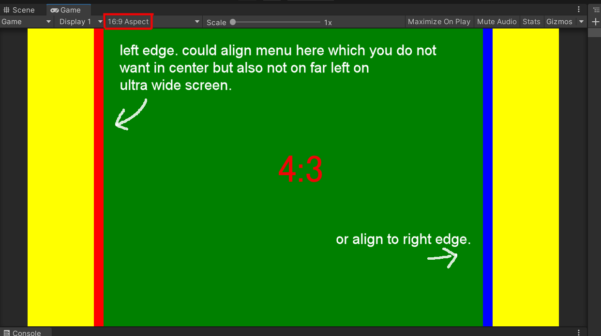

# Aspect ratio padding

Type: `FutureDigitalPlus.UIKit.Extras.AspectRatioPadding` (Runtime/Extras/AspectRatioPadding). Needs no style sheet or theme variable.

## Upstream description



This element will add padding/margin to the left and right and update it such to push the "central" items to fit into
a certain aspect ratio. So, if you choose to have a 4:3 ratio but this element is at 16:9 then padding is added to the
left and right, same for when you design at 16:9 but the game is played on ultra wide. For anything at or below your
design ratio the padding will be 0.

Sample, 4:3 design on 16:9 "display".

```xml
<ui:UXML xmlns:ui="UnityEngine.UIElements" xmlns:uie="UnityEditor.UIElements" editor-extension-mode="False">
    <FutureDigitalPlus.UIKit.Extras.AspectRatioPadding width="4" height="3" style="flex-direction: row; background-color: yellow;">
        <ui:VisualElement style="width:20px; background-color: red;" />
        <ui:VisualElement style="flex-grow:1; background-color: green;" />
        <ui:VisualElement style="width:20px; background-color: blue;" />
    </FutureDigitalPlus.UIKit.Extras.AspectRatioPadding>
</ui:UXML>
```

(The same sample is in `Samples~/Extras/AspectRatioPadding.Sample.uxml`.)

## Notes

- Attributes: `width` and `height` (integers, default 16 and 9) are the design ratio. They are read from UXML only;
  `RatioWidth` and `RatioHeight` have private setters.
- The element sets itself to 100% width and height, `flex-direction: row` and `flex-shrink: 0`, and writes
  `margin-left` and `margin-right` inline. Do not set those two margins yourself.
- It re-evaluates on every `GeometryChangedEvent`, so it follows window resizes and rotation.
- It only pads the sides. Portrait play on a narrow phone, where the design is wider than the screen, gets no padding
  (the 0 case) and is not letterboxed vertically.
- Safe area insets are not handled here; use the UIKit facade for that.
