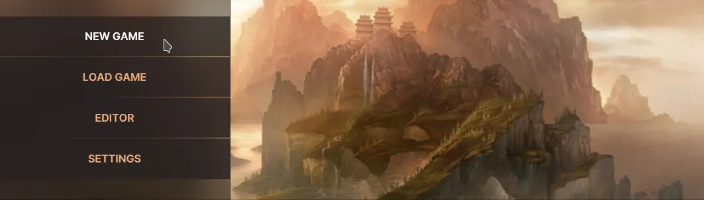
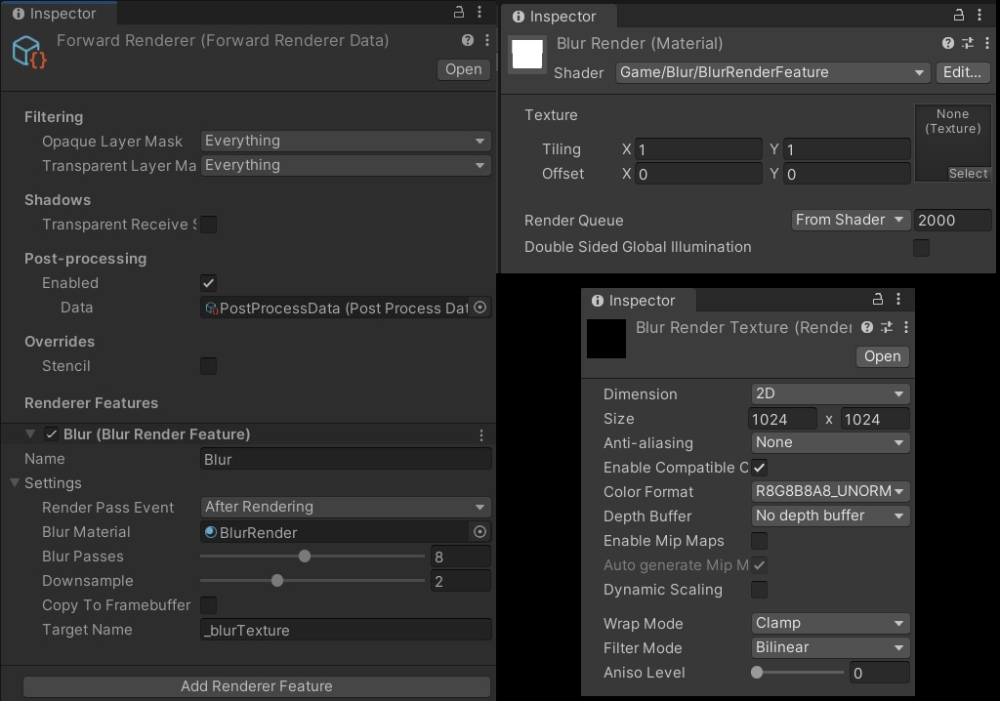
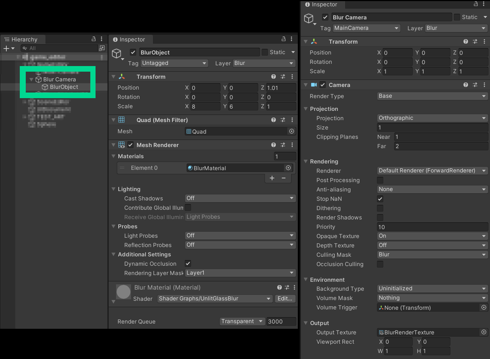

# Blur / glass effect

Types: `FutureDigitalPlus.UIKit.Extras.BlurPanel` (shows a texture behind a panel) and `BlurSource` (makes the blurred texture; new, not upstream), both in
`Runtime/Extras/BlurOrGlassEffect`. The URP render feature, shader and Shader Graph of upstream are **not** part of the compiled module; see "What was left out" below.

## Upstream description



An example of doing a blur or milky glass effect. I am using URP but this could be adopted for other since a main
part of this is a Rendertexture which provides the panel with the image information it needs.

You can insert the Blur Panel like any other element into UXML, or via C#.

```xml
<FutureDigitalPlus.UIKit.Extras.BlurPanel name="scene-toolbar" class="toolbar-back">
```

Then in C# you need to tell it about the blur image (render texture).

```cs
[SerializeField] private Texture blurTexture;
...
root.Q<BlurPanel>("scene-toolbar").SetImage(blurTexture);
```

If the Blur Panel is inside other elements that might move then you need to specify the moving parent too else the
Blur will not update correctly.

```cs
panel.SetImage(blurTexture, someParentElement);
```

Shader information from https://github.com/ArneBezuijen/urp_kawase_UI_blur and
https://github.com/sebastianhein/urp_kawase_blur and cleand up for this project.

Add the Blur Render Feature to the Forward Renderer Data via inspector. A Blur Render camera is used to render only a
panel which uses a Blur material. Think of this camera as viewing the rendered world via a window (a plane using a blur
shader material) and then rendering that to a texture. This texture is then used by the UI element. Note the culling
mask and layer used by camera and plane object.





## What `BlurPanel` does in this package

`BlurPanel` is a UI Toolkit `Image` that shows the part of a texture that lies behind it. `SetImage(texture)` stretches
the texture over the whole document and sets `sourceRect` to the panel's slice of it, updated on every geometry change.
It does not blur anything itself: the texture must already be blurred, and it must cover the whole panel (same aspect
ratio as the document). Where the texture comes from is up to the game: a blurred render texture, a pre-blurred
screenshot taken when a menu opens, or a static background image all work.

With no texture set it is just a visual element with a background, so every `PopupPanel` (whose inner panel is a
`BlurPanel`) costs nothing extra unless you give it a blur source.

## `BlurSource`: a blurred texture on any render pipeline

`BlurSource` runs a Kawase blur (the average of four bilinear taps whose distance grows with each pass) with `Graphics.Blit` between two render textures, using the plain CG shader
`Hidden/FutureDigitalPlus/UIKit/Blur/Kawase` (`Resources`: `FutureDigitalPlus/UIKit/Extras/Shaders/Kawase`). It needs no renderer feature, so the same code works in the Built-in pipeline, URP and HDRP.

```cs
// 1. a texture you already have (a screenshot, a background image, another render texture)
RenderTexture blurred = BlurSource.Blur(sourceTexture, downsample: 2, iterations: 4);

// 2. a camera: renders it once into a reduced size texture, then blurs
RenderTexture world = BlurSource.FromCamera(Camera.main, downsample: 4, iterations: 3);

// 3. refresh a texture a panel already shows (no allocation)
BlurSource.Blur(sourceTexture, existingRenderTexture, iterations: 4);

root.Q<BlurPanel>("scene-toolbar").SetImage(blurred);
// ... when the menu closes:
blurred.Release(); Object.Destroy(blurred);
```

| API | What |
|---|---|
| `Blur(Texture source, int downsample = 2, int iterations = 4)` | New `RenderTexture` of `source size / downsample` that **the caller owns** (release and destroy it). Null with a warning if the shader is missing or unsupported |
| `Blur(Texture source, RenderTexture destination, int iterations = 4)` | Blurs into an existing texture at its size. The last pass always lands in `destination` (a scratch texture is used for the passes in between) |
| `FromCamera(Camera camera, int downsample = 2, int iterations = 4)` | Renders the camera once, at reduced size, into a temporary texture and blurs it. The camera keeps its own `targetTexture`. UI Toolkit panels are not in the capture |
| `IsSupported` | The shader is in the build and the graphics device can run it |
| `TargetSize`, `ClampIterations` | The pure size and clamp rules (`downsample` 1..16, passes 1..12) |

Call it from the main thread and outside a render callback. It blurs **once, when called**: do it when a menu opens, not every frame (see the cost section below).
`downsample` divides the size, so 2 to 4 is cheaper and softer. Each pass is one full pass over the reduced texture; about 4 passes give a soft glass look.

State of verification: the blur itself was run on a black and white step image on the Built-in pipeline, URP 3D and HDRP (the far pixels keep their value, the edge
becomes a blend; `Tests/Runtime/Platform/BlurSourceTests.cs`). `FromCamera` ran in the test `BlurSourceTests.FromCamera_BlursWhatTheCameraSees_AndRestoresTheCamera` on the Built-in pipeline, URP 3D and 2D and HDRP (a uniform red scene stays red; HDRP's exposure lowers the value to about 0.57):
`Camera.Render()` outside the render loop is the supported way to capture in Built-in, and it worked in the others; run that test in your project before relying on it for a different setup. A screen capture source
(`ScreenCapture.CaptureScreenshotIntoRenderTexture`) can feed `Blur` too but returns nothing in batch mode and was not tried. The shader file ships in every player.

## What was left out, and why

Upstream's `BlurOrGlassEffect/Shaders` folder holds `BlurRenderFeature.cs` (a URP `ScriptableRendererFeature`),
`BlurRenderFeature.shader`, `BlurRender.mat` and `UnlitGlassBlur.shadergraph`. They are kept verbatim, without `.meta`
files, in `Samples~/Extras/BlurUrpLegacy~/` (the trailing `~` stops Unity importing them) and are not compiled because:

1. The render feature uses the pre Unity 6 URP API (`Configure`, `Execute(ref RenderingData)`, `FrameCleanup`,
   `renderer.cameraColorTarget`, `cmd.Blit`). In Unity 6 URP renders through the Render Graph and these overrides are
   only called in Compatibility Mode, which is deprecated, and `cameraColorTarget` is obsolete and not meant for Render
   Graph use. It needs a rewrite (`RecordRenderGraph`), not a patch.
2. The blit shader is a built in pipeline style `CGPROGRAM` shader that expects a mesh and `_MainTex`. URP 17's blit
   utilities draw a procedural full screen triangle and bind `_BlitTexture`, so the shader needs a rewrite as well.
3. It makes the module depend on URP, the Shader Graph package and a specific renderer setup, which would break the
   rule that a game can use any module on its own. A game on the built in pipeline, or URP 2D like Solitaire, could not
   use the module.
4. The test project has no URP, so a rewritten feature could not be compile checked in this step.

For a texture that is blurred once and then shown, use `BlurSource` above. A blur that must follow the scene **every frame** still needs a pass written for the Render Graph in that game
(or in a later separate module guarded by a `versionDefines` entry for `com.unity.render-pipelines.universal`); hand its texture to `BlurPanel.SetImage`.

## Cost on mobile: judgement

`BlurPanel` itself is cheap: one textured quad per panel, one rectangle update when the layout changes.
The upstream live blur pipeline (kept for reference) is not cheap on phones:

- **Passes.** Default 6 passes (range 2..15) at half resolution, each pass a 5 tap bilinear filter. That is about 7.5
  full resolution pixel reads per screen pixel, per frame, against 1 for a plain copy. At `downsample` 4 it is about a
  quarter of that, and quality drops.
- **Framebuffer readback.** It samples the camera colour target after rendering (`AfterRendering`). On tile based GPUs
  (all iPhones, most Android) reading the colour target forces the tile memory to be stored to main memory and
  reloaded, which costs bandwidth and heat and can break pass merging. This is the most expensive part on mobile.
- **Always on.** The pass runs every frame while the feature is enabled, whether or not a blur panel is visible. Enable
  it only while a blurred panel is on screen.
- **Extra camera and geometry.** The setup renders a second camera and a plane just to produce the texture.
- **Memory.** Two temporary ARGB32 render targets at 1/downsample of the screen (about 3 MB each at 1170x2532 with
  downsample 2).
- **Content only.** The blurred image is the camera's output before the UI Toolkit panel is drawn, so it blurs the game
  world only, never other UI elements behind a popup.

Recommendation for mobile: do not run a per frame full screen blur. Capture one blurred frame when the popup or menu
opens (or use a pre blurred background asset), pass it to `SetImage`, and release it on close. For low end devices fall
back to the plain translucent panel. Keep any live blur a quality option that is off by default on mobile.
