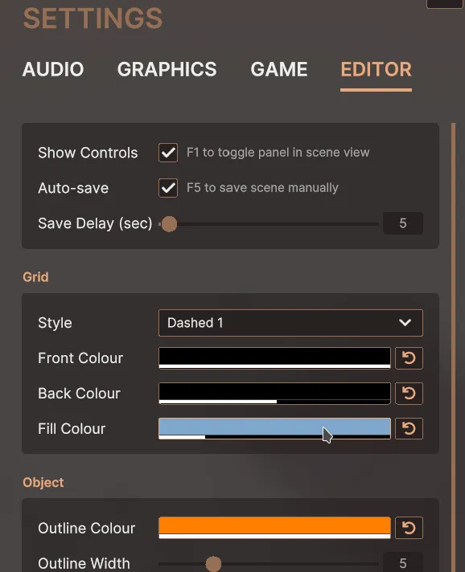

# Colour field and picker

Types: `FutureDigitalPlus.UIKit.Extras.ColorField`, `FutureDigitalPlus.UIKit.Extras.ColorPopup`, `FutureDigitalPlus.UIKit.Extras.Slider2D`, `FutureDigitalPlus.UIKit.Extras.DragManipulator`
(Runtime/Extras/ColorFieldAndPicker). Style sheets: `ColorFieldStyleSheet`, `ColorPopupStyleSheet`,
`Slider2DStyleSheet`. Depends on the popup panel (`ColorPopup` derives from `PopupPanel`).

## Upstream description



A Color field and Color picker popup. You will need the popup and blur panel related scripts too if you want to use it
as is (they are all in this module).

The popup element should be at bottom of the document's root so that it can appear over other elements.

```xml
    ...
    <FutureDigitalPlus.UIKit.Extras.ColorPopup name="color-popup" start-visible="false" />
</ui:UXML>
```

Insert the color field somewhere via UXML.

```xml
<FutureDigitalPlus.UIKit.Extras.ColorField name="grid-fill-color" label="Fill Colour" reset-label="\U0000f0e2" />
```

Link the color field with the color popup.

```cs
var colorPopup = root.Q<ColorPopup>("color-popup");
var gridFillColorField = root.Q<ColorField>("grid-fill-color");
gridFillColorField.ColorPopup = colorPopup;
gridFillColorField.ResetButtonPressed += () => gridFillColorField.value = Const.DefaultGridFillColor;
```

## Notes

- `reset-label` is the text of the optional reset button. Upstream uses an icon font glyph; any string works.
- `ColorPopup.Show(color, onSubmit)` can also be called directly. The callback receives the colour (alpha included)
  when the player presses the submit button; closing the popup in any other way does not call it.
- The picker draws a 64x64 gradient texture and a 1x64 hue texture each time it is shown and destroys them on hide
  (point filtered, no mip maps). Cheap, but it allocates; do not open it every frame.
- `Slider2D` is a reusable two axis slider (`BaseField<Vector2>`, range 0..1 by default). `DragManipulator` is the
  `Clickable` subclass behind it.
- Keyboard and gamepad: the colour swatch of a `ColorField` is focusable and opens the picker on Submit (Enter, gamepad south). A `Slider2D` is focusable too. Submit starts editing
  (class `fdp-slider-2d--editing`, with a ring on the knob); while editing the arrows, WASD (as the navigation mapping reports them) and the D-pad move the value by `KeyStepFraction`
  (5 percent of the range; Shift: 25 percent); Submit, Cancel or leaving the control ends editing. Outside editing the directions move focus as usual, so focus can never get stuck in the picker.
- Pointer handling in `DragManipulator` relies on Unity's own `Clickable` pointer handlers. It compiles and is
  constructed in the tests, but interactive dragging with mouse and touch has not been verified in a player build.
- The edit time `Object.Destroy` calls in `ColorPopup.Hide` are fine in play mode; do not use the popup in an
  EditorWindow.
