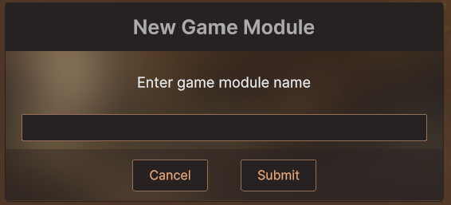
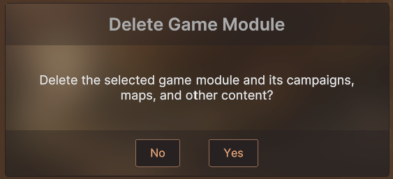

# Popup panels

Types: `FutureDigitalPlus.UIKit.Extras.PopupPanel`, `...PopupMessage`, `...PopupTextField` (Runtime/Extras/PupupPanel; the upstream
folder name has a typo and is kept so updates diff cleanly). Style sheets: `FutureDigitalPlus/UIKit/Extras/Styles/PopupPanelStyleSheet`,
`PopupMessageStyleSheet`, `PopupTextFieldStyleSheet`. Theme variables: `--fdp-color-back-*`, `--fdp-color-txt-*`,
`--fdp-color-screenfill-translucent` (optional overrides; the colours default to the DesignSystem tokens, see the module README).

## Upstream description




Examples of how modal popup panels can be done. These will add a fullscreen element to prevent mouse clicks from
reaching elements behind. Of course these need to be added to the root of a document and at the bottom so they appear
over other elements.

```xml
    <FutureDigitalPlus.UIKit.Extras.PopupPanel name="settings-popup" class="settings-popup" start-visible="false">
        <ui:Instance template="SettingsPanel" class="settings-panel fill" />
        <ui:Button text="\U0000f00d" name="popup-close-button" class="popup-close-button" />
    </FutureDigitalPlus.UIKit.Extras.PopupPanel>

    <FutureDigitalPlus.UIKit.Extras.PopupTextField name="popup-textfield" start-visible="false" />
    <FutureDigitalPlus.UIKit.Extras.PopupMessage name="popup-message" start-visible="false" />
</ui:UXML>
```

`FutureDigitalPlus.UIKit.Extras.PopupPanel` can be used to contain whatever you want to be in a popup panel (for example a Settings panel) or
you can derive from it to create a more specialised popup, like the included PopupTextField, PopupMessage, and
ColorPopup examples.

```cs
var popupMsg = root.Q<PopupMessage>("popup-message");
var popupEd = root.Q<PopupTextField>("popup-textfield");

popupMsg.Show("Lable", "message", "Close");

// 20 = how many characters allowed
popupEd.Show("label", "message", "empty or text to set", 20,
    t =>
    {   // submit was pressed
        popupEd.Hide();
        Debug.Log("Player entered: " + t);
    },
    () =>
    {   // cancel was pressed
        popupEd.Hide();
    });
```

## Notes

- `PopupMessage.Show(heading, message, cancelLabel)` shows a single button (it calls the full overload with no accept
  callback and `Hide` as the cancel callback). A button is hidden when its callback is null.
- `PopupMessage` does not hide itself after the accept button; call `Hide()` in your callback.
- Each popup's inner panel is a `BlurPanel`, so `popup.SetBlurSource(texture)` can give it a blurred background. Without
  a texture it is a plain translucent panel and costs nothing extra (see the blur guide).
- Show and Hide fade with the UI scheduler (`fade-time` attribute, ms per 10 percent step; 0 disables the fade).
- The overlay element is full screen and takes pointer input, which is what blocks the UI behind it.
- Keyboard and gamepad: while a popup is open, focus cannot leave it (UI Toolkit's navigation spans the whole panel, so Tab or the D-pad would otherwise walk onto the page behind).
  `Show` remembers the focused element and `Hide` gives focus back to it; Cancel (Escape, gamepad B) closes the popup when it holds focus.
- Back key: on a touch device nothing holds focus, so the Android back button never reaches the popup as Cancel. Assign `PopupPanel.BackRegistrar` (a `Func<Action, IDisposable>`) to
  register the popup's close action with your back dispatcher while it is open; the Extras module references no dispatcher itself. The default is null.
