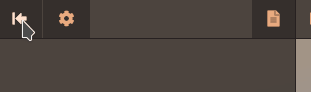

# Tooltip

Types: `FutureDigitalPlus.UIKit.Extras.Tooltip`, `FutureDigitalPlus.UIKit.Extras.TooltipManipulator` (Runtime/Extras/Tooltip). Style sheet:
`FutureDigitalPlus/UIKit/Extras/Styles/TooltipStyleSheet` (colours from the DesignSystem tokens, see the module README).

## Upstream description



UIElements does not have tooltip support at runtime. Here's some code to show how you can get it working.

You want to add something like this near the end of a UXML document. It needs to be at the end so that the tooltip
will appear over other elements and not behind them.

- Delay is how long it waits (ms) before it shows up.
- Fade Time is how how quick or slow it fades in and out. 0 for no fade.

```xml
<FutureDigitalPlus.UIKit.Extras.Tooltip name="tooltip" picking-mode="Ignore" delay="500" fade-time="15" />
```

Now you need to bind this to all the buttons and other elements which can show a tooltip. You probably have some c#
script where you are doing all kinds of bindings already so just put it in there.

```cs
var tooltip = root.Q<Tooltip>("tooltip");
var button = root.Q<Button>("some-button");
button.AddManipulator(new TooltipManipulator(tooltip));
```

The tooltip text comes from an element's tooltip attribute, for example ...

```xml
<ui:Button name="some-button" text="Button" tooltip="Settings" />
```

The tooltip will appear below the item by default but you can also hint to it to appear above, or to the left or
right. Simply attach the following in front of the tooltip text to apply the hint. "L:" for left, "R:" for right, "T:"
for above, and "B:" for below.

For example, to have the tooltip appear to the right-hand side of a button you would do this

```xml
<ui:Button name="some-button" text="Button" tooltip="R:Settings" />
```

## Notes

- The manipulator shows the tooltip in three situations: mouse hover (upstream), keyboard or gamepad focus, and a long press with a finger.
  - Focus: the tooltip of the focused element shows only while an ancestor carries the class `fdp-input-nav` (`TooltipManipulator.NavigationClass`), which the Interaction module's
    `InputProfile` writes while the last device was a keyboard or gamepad. After a mouse click the element keeps focus but no tooltip appears. Without that class focus never shows a tooltip.
  - Touch: a finger held for `LongPressDelay` (500 ms) without moving more than 10 px shows it; it stays `LongPressLinger` (1500 ms) after the finger lifts. A tap does nothing,
    and no tooltip is left open by the compatibility mouse events of a tap: the hover path listens to the pointer events and acts for the mouse only. The press is read in the trickle-down
    phase, so it also works on a `Button`, whose own click handling stops a `PointerDown` at the target.
- The tooltip is placed in the local space of its parent (`WorldToLocal` and layout sizes), so it is correct in panels with a scale and in world-space panels, where `worldBound` is in world units.
- The tooltip is positioned from its own current size, measured before the new text has been laid out. A tooltip whose
  text length changes a lot may sit a few pixels off on its first display.
- Position is clamped to the tooltip's parent, so put it in the full screen root of your document.
- The fade uses the UI scheduler (`Delay`, `FadeTime` in ms), not Unity time scale.
